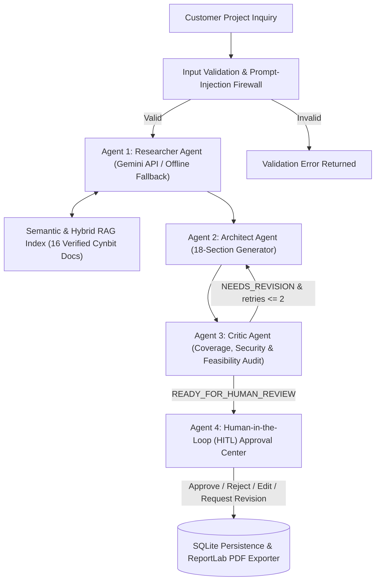

# Cynbit AutoBlueprint — System Architecture & Multi-Agent Specification

## 1. Architectural Overview
**Cynbit AutoBlueprint** is a 4-stage Multi-Agent System (MAS) and Hybrid Retrieval-Augmented Generation (RAG) application built for [Cynbit Technologies](https://www.cynbit.in/). It automates initial technical discovery and 18-section architectural blueprinting for customer inquiries submitted via [cynbit.in/contact](https://www.cynbit.in/contact) while enforcing the **Human-in-the-Loop (HITL)** governance principles described in [How AI Agents Are Transforming Business Operations in 2026](https://www.cynbit.in/blog/ai-agents-business-operations).

## 2. Dual-Mode Execution & LangGraph Topology
- **Live Gemini API Mode (`LIVE_GEMINI_API`)**: Activated when `GEMINI_API_KEY` is provided in `.env` or environment variables. Calls Gemini (`gemini-2.5-flash`) via `services/llm_client.py` (`google-genai` SDK, `google-generativeai` SDK, or Gemini v1beta REST API) with `response_mime_type="application/json"` and validates outputs via Pydantic (`ResearcherLLMOutput`, `ArchitectLLMOutput`, `CriticLLMOutput`).
- **Offline Demonstration Mode (`OFFLINE_DEMO_MODE`)**: Activated automatically when `GEMINI_API_KEY` is omitted or when an API error occurs (`OFFLINE_FALLBACK_AFTER_API_ERROR`). Executes deterministic requirement extraction, architecture synthesis, and Critic auditing while clearly labeling the active mode in the UI and execution logs.
- **LangGraph Orchestration (`orchestration/graph.py`, `orchestration/workflow.py`)**: Instantiates `langgraph.graph.StateGraph(WorkflowStateTypedDict)` when `langgraph` is installed, and falls back to `FallbackStateGraph` in offline sandboxes.

